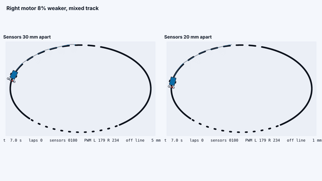
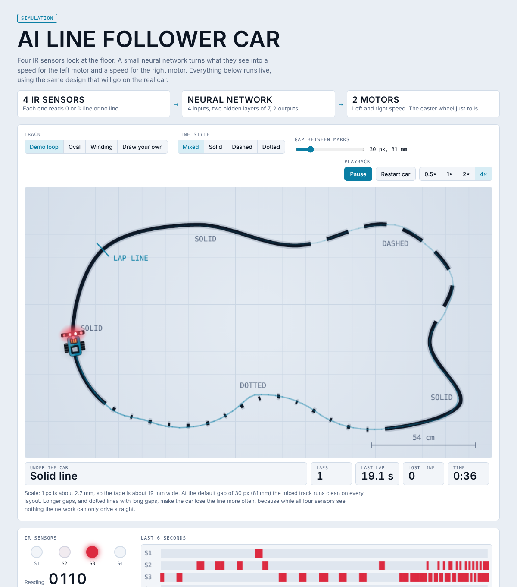
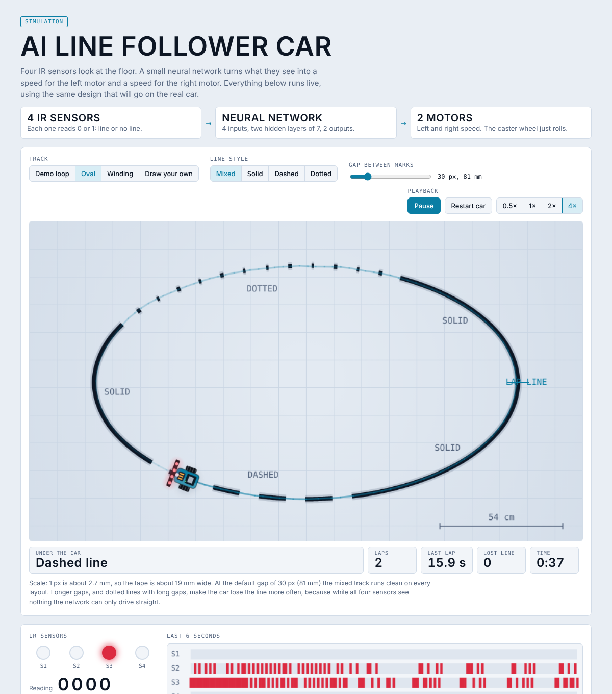
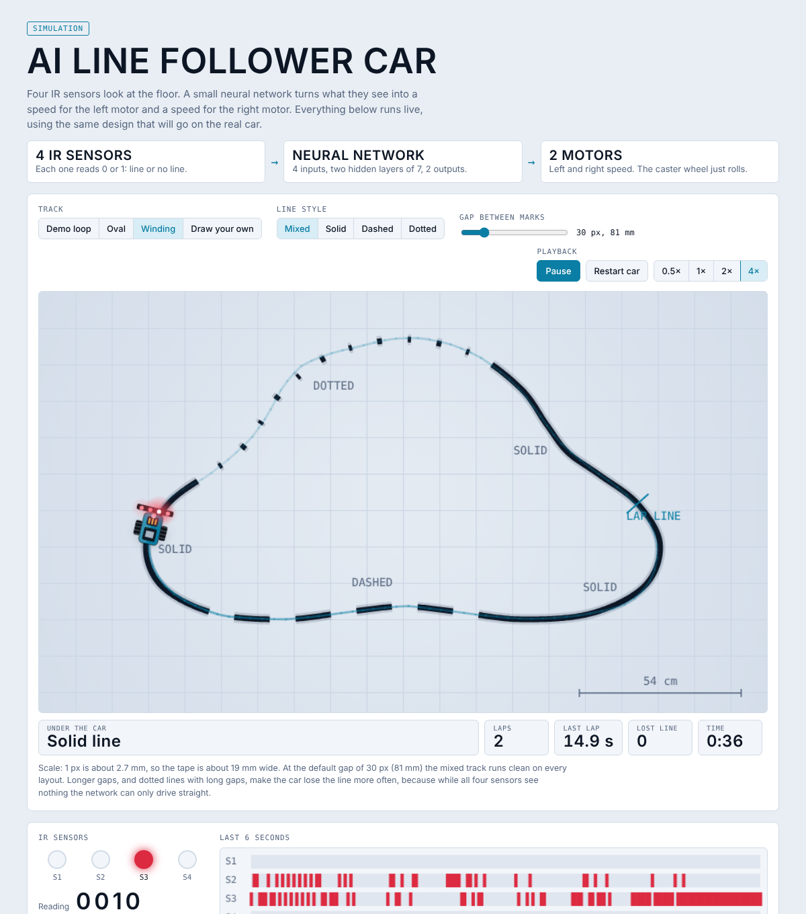
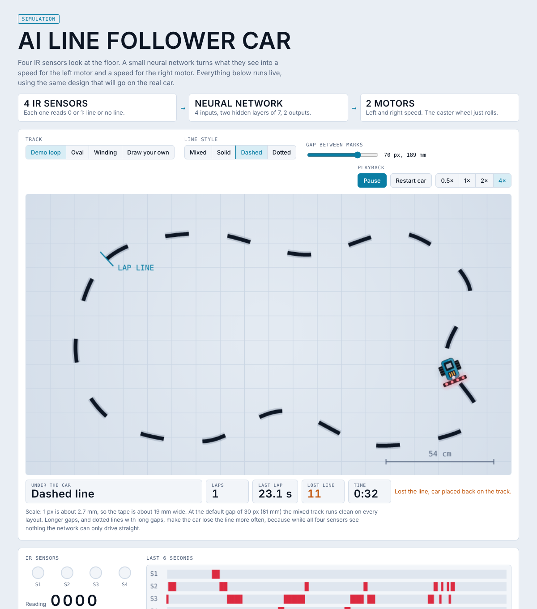

# AI line follower car

**Live demo (3D car driven by the trained network): https://manishkshtriya.github.io/linefollower-ai/**

**New: the network learned to drive in the simulator** (clean runs 141 → 205 of 240 random cars). Video: [`sim/ai_learns_the_fix.mp4`](sim/ai_learns_the_fix.mp4), details: [`learn/README.md`](learn/README.md)

**Simulation video (the real firmware driving a virtual car):** [`sim/line_follower_sim.mp4`](sim/line_follower_sim.mp4)

A two-wheel car with a caster wheel in front. Four IR sensors look at the floor, a small neural network
(4 inputs, two hidden layers of 7, 2 outputs) turns the sensor pattern into a left and a right motor speed.
The whole network is 107 numbers (428 bytes), so it runs on an ESP32 and needs no Jetson.

The goal is to follow solid, dashed and dotted lines and to come back to the line when it drifts off.

## Output (simulation)

Screenshots from the browser simulator, running the trained network on the same sensor layout as the car.
The red dots are the four sensors, the panels below the track show the live sensor reading, motor speeds, laps and lost-line count.
These are simulation outputs only. The firmware has not been run on a real car yet.

**Demo loop** (solid, dashed, solid, dotted, solid)

**Oval**

**Winding track**

**Long gap (70 px, 189 mm) on dashed tape.** The car starts losing the line, which is the known limit.

## What is in this folder

| Path | What it does |
|---|---|
| `training/train.py` | Trains the network with numpy and writes `weights.h` and `weights.json` |
| `firmware/sensor_test/sensor_test.ino` | Step 1: prints the four sensor readings so you can check the wiring |
| `firmware/linefollower/linefollower.ino` | The car program: reads sensors, runs the network, drives the motors |
| `firmware/linefollower/nn.h` | The network forward pass in C |
| `firmware/linefollower/weights.h` | Trained weights (generated, replace after every training run) |
| `docs/` | Project website (`index.html`, served by GitHub Pages) and simulation screenshots |
| `learn/` | The network learns by itself in the simulator (evolution strategy). The firmware now uses these learned weights |
| `sim/` | Firmware-in-the-loop simulator: runs `linefollower.ino` unchanged against a virtual car. See `sim/README.md` |
| `wokwi/` | Ready-made Wokwi ESP32 circuit: run the real firmware in the browser with switches as sensors |
| `tests/check.py` | Checks that the C code gives the same answers as the Python network |

## Hardware

- ESP32 DevKit board (Arduino-ESP32 core 3.x)
- 4 IR reflective sensor modules (TCRT5000 type) or one 4-channel array, mounted **about 20 mm apart** (centre to centre) for 19 mm tape
- TB6612FNG motor driver
- 2 geared DC motors with wheels, 1 caster wheel, chassis
- Battery pack for the motors, 5 V supply (power bank or regulator) for the ESP32
- Black electrical tape on a light floor

### Wiring

| ESP32 pin | Connects to |
|---|---|
| GPIO 34, 35, 32, 33 | Sensor outputs S1 (far left) to S4 (far right), looking forward |
| GPIO 25, 26, 27 | TB6612 PWMA, AIN1, AIN2 (left motor) |
| GPIO 4, 16, 17 | TB6612 PWMB, BIN1, BIN2 (right motor) |
| GPIO 23 | TB6612 STBY |
| 3V3 | Sensor VCC and TB6612 VCC |
| GND | All grounds joined: sensors, TB6612, battery, ESP32 |

Motor battery goes to TB6612 VM. Left motor on output A, right motor on output B.

## Steps

1. **Check the sensors.** Flash `sensor_test.ino`, open the Serial Monitor at 115200 baud and slide the car over the tape.
   You should see patterns like `0110` when the line is in the middle. If 1 and 0 are swapped, set `LINE_IS_HIGH` to `false`
   in both sketches. Turn the small potentiometer on each module until it switches cleanly.
2. **Train.** `cd training && python3 train.py --out ../firmware/linefollower/weights.h` (needs only numpy).
3. **Check the C code.** From this folder run `python3 tests/check.py`. It should print `OK`.
4. **Flash** `linefollower.ino` with the wheels off the ground first. If a wheel turns the wrong way, set
   `LEFT_REVERSED` or `RIGHT_REVERSED` to `true`. Raise `MIN_DUTY` if the motors do not start at low speed.
5. **Test on the floor**, starting with a solid line, then dashed, then dotted.

## Firmware-in-the-loop simulation

`sim/hil_sim.cpp` compiles the real `linefollower.ino` on a PC and connects its pins to a virtual car with motor
stall, motor lag, sensor spot size, weak-motor and noise faults. It found that **sensor spacing is the most
important build choice**: with 19 mm tape, sensors 20 mm apart passed 11 of 12 hard scenarios, and sensors 30 mm
apart passed only 5. With 20 mm spacing the car ran clean on solid, dashed and dotted tape, with an 8% weaker motor,
with 3% wrong sensor reads and with gaps up to 135 mm. Gaps of 189 mm still lose the line. Details and commands are in
[`sim/README.md`](sim/README.md).

## Training on the real car (recommended)

The built-in table has 16 rows, one per sensor pattern, labelled by a hand-written rule. That is enough to get the car
moving, but it only copies the rule. To make the network learn from the real car, log driving data and train on that:

1. Drive the car along solid, dashed and dotted tape (by hand, remote control or a slow version of the rule)
   and log one row per control step: `s1,s2,s3,s4,left,right`.
2. Save it as `my_drive.csv` and run `python3 train.py --csv my_drive.csv`.

The sensor inputs can also be made analog (read the sensor with `analogRead`, scale to 0 to 1) so the network sees
how much line is under each sensor. This gives it much more to work with than the 16 on/off patterns.

## Results in simulation

The simulated car has a 30 mm sensor spacing, 19 mm tape and an 81 mm distance between the drive wheels. Each run is 120 seconds.
The network was trained with `train.py` (final error 2.4e-6 after 2400 steps) and then driven in the simulator.

| Layout | Lap length | Laps in 120 s | Lost the line |
|---|---|---|---|
| Demo loop (solid, dashed, solid, dotted, solid) | 5.6 m | 6 | 0 |
| Oval | 4.6 m | 7 | 0 |
| Winding | 4.3 m | 8 | 0 |

Longer gaps are harder. On the mixed demo loop the number of times the car lost the line in 120 seconds was
0 at a 30 px (81 mm) gap, 6 at 50 px, 18 at 70 px and 29 at 90 px. While all four sensors see nothing, the
network can only drive straight, and on a curve that eventually takes the car off the line.
A track made only of dashes or only of dots is harder than the mixed track: on the demo loop, 6 lost-line events for
dashes and 21 for dots at the 30 px gap, while the oval had none.

## Known limits

- The firmware has not been run on a real car yet. The C forward pass is checked against Python (`tests/check.py`),
  and the same weights drive the simulated car, but motors, sensor spacing and lighting will need tuning.
- The simulation assumes sensor spacing close to the tape width. If your sensor board has a smaller pitch,
  use thicker tape, space the modules out, or retrain on real logged data.
- With the built-in table the network reproduces the hand-written rule. The benefit of the neural network grows
  when it is trained on real driving data or analog sensor values.
- The car stops if no sensor sees the line for 1.5 seconds (`LOST_STOP_MS`).
